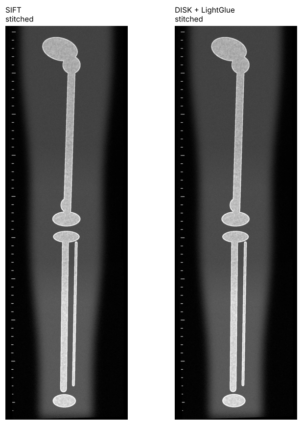
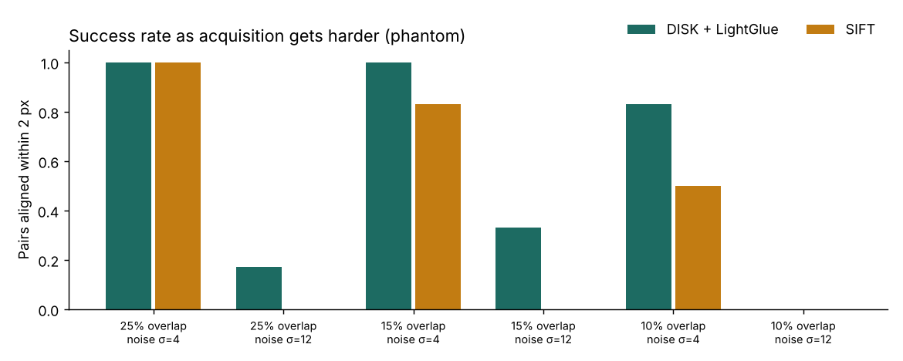

# 🦴 X-Ray Stitch

**Stitching overlapping radiograph exposures into one full-length image, and measuring whether learned feature matching beats the classical pipeline.**

Long-leg and full-spine radiographs are taken as several overlapping exposures, because one detector is not tall enough. Each shot differs slightly in position, angle and brightness. A misalignment of a few pixels at the seam turns into an error in measured leg length or spinal angle, so stitching accuracy is a clinical question, not a cosmetic one.

Radiographs are hard to stitch: large smooth regions, few distinct corners, repetitive structures and a different exposure per shot. This project compares two ways of finding matching points between segments, with everything else held equal.

| | Method | Idea |
|---|---|---|
| **Classical** | CLAHE + SIFT + ratio test | Hand-designed gradient features |
| **Learned** | DISK + LightGlue (via Kornia) | Features and matching learned from millions of image pairs |

Both feed the same RANSAC similarity estimate (rotation, scale, translation) and the same distance-weighted feather blending.

## Measuring accuracy, not judging by eye

A full image is cut into overlapping "exposures" with random misalignment, exposure changes and detector noise that **we generate**, so the true transform of every segment is known. Error is the mean pixel distance between where the estimated and true transforms put a grid of points. We report:

- **Pair error:** accuracy of each seam
- **End-of-chain error:** errors accumulate from hip to ankle, so this is what a measurement at the far end would see
- **Success rate:** share of seams aligned within 2 px

## Results (procedural phantom, 3 exposures)



| Method | Seam 1→2 error | Seam 2→3 error | End-of-chain error | Inliers per seam | Time per seam (CPU) |
|---|---|---|---|---|---|
| SIFT | 0.97 px | 0.13 px | 2.38 px | 36–50 | ~0.2 s |
| DISK + LightGlue | 0.51 px | 0.20 px | 1.20 px | 148–209 | ~7.5 s |

**Stress test:** smaller overlap and higher noise, 3 random poses per condition.



- At normal acquisition (25% overlap, low noise), both methods align every seam; the learned matcher halves the end-of-chain error.
- As overlap shrinks, SIFT starts failing first: at 10% overlap it aligned half the seams, versus 83% for DISK + LightGlue.
- At high noise, **both** methods mostly fail. Neither is safe without a confidence check, which is why the pipeline reports failure instead of returning a bad stitch.
- The learned matcher's accuracy costs about 35× more compute on CPU. On a GPU the gap is far smaller.

## Run it

```bash
pip install -r requirements.txt
pytest                                   # fast tests (classical pipeline)
RUN_DEEP=1 pytest                        # include the learned matcher (downloads weights)
jupyter notebook notebooks/xray_stitching.ipynb
```

Or open the notebook in Google Colab with a GPU runtime. To test on real radiographs, put PNG or JPG files in `data/images/` and use images you have the right to use.

## What's inside

| Part | What it does |
|---|---|
| `notebooks/xray_stitching.ipynb` | Full comparison, figures and stress test |
| `xraystitch/phantom.py` | Procedural long-leg radiograph phantom, so no patient data is needed |
| `xraystitch/synth.py` | Splits an image into exposures with known ground-truth transforms |
| `xraystitch/matchers.py` | SIFT and DISK + LightGlue matchers, with padding-border masking |
| `xraystitch/stitch.py` | Pairwise registration, chaining, feather blending, error metrics |
| `tests/` | Ground-truth consistency, accuracy and failure-reporting tests |

## Limitations

- Simulated misalignment is 2D. Real exposures also differ by parallax and patient movement between shots.
- DISK and LightGlue are pretrained on natural photographs, not radiographs.
- The phantom is simplified anatomy; results need confirming on real radiographs.

## Next steps

- Fine-tune the learned matcher on radiograph pairs
- Use the calibration ruler as an explicit alignment cue
- Report alignment confidence to the radiographer, so poor stitches are caught before measurement

## Credits

DISK (Tyszkiewicz et al., 2020) and LightGlue (Lindenberger et al., 2023), used through [Kornia](https://github.com/kornia/kornia).

---

Built by **Ebby Lari**, biomedical engineer working on medical imaging and devices for low-resource settings.
